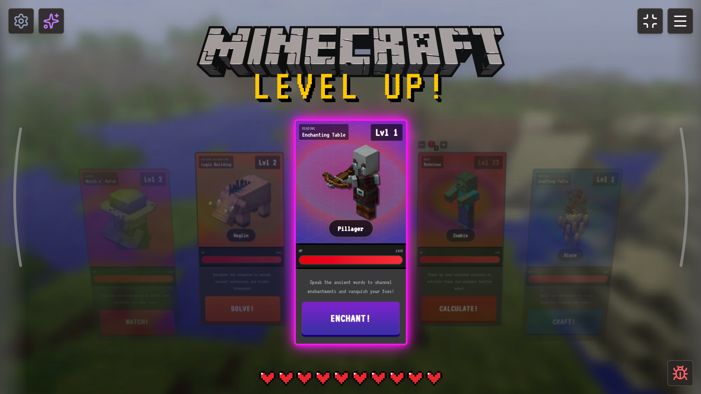

# Level Up RPG

An educational RPG where kids level up 6 real-life skills (Reading, Math, Writing, Cleaning,
Memory, Patterns) by beating mobs in themed mini-games. React + Vite in the browser, packaged
as a portable Windows `.exe` with Electron.

This repository is the *CodeWash* project: a legacy, vibe-coded codebase that we stabilize,
test and clean. See [`docs/DEBT.md`](docs/DEBT.md) for what is wrong and in which order we fix it.



---

## Quick start

```bash
npm ci        # install (~15 s)
npm run dev   # open http://localhost:5173
```

That's it. No env file, no backend, no database — all progress is stored in `localStorage`.

**Requirements:** Node.js 20+ (CI uses 20) and npm. Use a Chromium browser (Chrome/Edge):
the Reading mini-game needs `webkitSpeechRecognition` and will not work in Firefox or Safari.

## Commands

| Command | What it does |
|---|---|
| `npm run dev` | Dev server with hot reload on `:5173` |
| `npm run build` | Production build into `dist/` |
| `npm run preview` | Serve the production build locally |
| `npm run electron:dev` | Build, then run the desktop app |
| `npm run electron:build` | Package the Windows portable `.exe` (**Windows only**) |
| `npm run lint` | ESLint |
| `npm test` | Run the test suite once |
| `npm run test:watch` | Run the tests in watch mode |
| `npm run test:coverage` | Run the tests with a coverage report |

A Windows `.exe` is also produced by CI on every push to `main`
([`build-exe.yml`](.github/workflows/build-exe.yml)) and attached to the release.

Every pull request is checked by [`ci.yml`](.github/workflows/ci.yml): lint, tests with coverage,
then build. A red run blocks the merge.

> The test suite is a **characterization** suite: it records what the code currently does,
> bugs included, so that refactoring stays reversible. It does not describe intended behaviour.
> Coverage is low on purpose for now, and its thresholds only ever go up — see `tests/`.

## Checking your setup works

Launch `npm run dev`, then: the main menu shows a carousel of 6 skill cards, arrow keys or
clicks switch cards, background music plays, and pressing a card's action button starts a battle.
Progress survives a page reload. If all of that is true, you're set up correctly.

## Project layout

```
src/
  App.jsx              # ~1500 lines: all game state, battles, profiles, voice input
  components/
    skills/SkillCard   # the 6 mini-games (one 780-line component)
    drawers/           # menu, settings, cosmetics side panels
    modals/            # reset, bug report
    ui/                # shared widgets + GlobalStyles (1300 lines of CSS-in-JS)
  constants/           # gameData (themes, mobs, words), achievements
  utils/               # gameUtils (rules/RNG), soundManager, achievementUtils
public/assets/         # images and sounds, served as static files
electron/main.cjs      # desktop shell, loads dist/index.html
docs/                  # project documentation
```

**Architecture in one paragraph.** Everything is client-side and there is no state container:
`App.jsx` owns the whole game state with `useState` and passes it down as props; `SkillCard`
holds the per-mini-game logic. Persistence, randomness, timers, audio and speech recognition are
called directly from the components — which is exactly why the project is hard to test today, and
why the refactoring separates those I/O concerns from the game rules.

**Where state lives:** `localStorage`, keyed by profile (3 profiles).

| Key | Content |
|---|---|
| `heroSkills_v23_p<id>` | Per-profile skills: level, XP, difficulty, badges, current mob |
| `currentProfile_v1`, `heroProfileNames_v1`, `heroParentStatus_v1` | Profile selection, names, parental unlock |
| `borderEffect_p<id>`, `borderColor_p<id>` | Cosmetics |
| `phantomEvent_lastSpawn_v1` | Cooldown of the random Phantom event |

`heroSkills_v23` (no profile suffix) is a legacy key, still read once and migrated into profile 1.

## Known issues

Confirmed on the version we received — details and priorities in [`docs/DEBT.md`](docs/DEBT.md).

- **All UI and mob sounds are silently dead.** Files sit in `public/assets/sounds/ui/ui/` and
  `sounds/mob/mob/`, the code requests `sounds/ui/` and `sounds/mob/` — 404, no error shown. Only BGM works.
- **Themes are incomplete.** 4 missing theme assets (`spy_logo.png`, `spy_memorycard.jpg`,
  `kpop_memorycard.jpg`, `pokemon_memorycard.jpg`); the Spy theme reuses the Minecraft background;
  only the Minecraft theme defines mob art.
- ~~374 of the 660 tracked files are macOS `._*` junk, and there is no `.gitignore`~~ —
  fixed: untracked and ignored, lint is now clean. Tracked files went from 663 to 289.
- **Dead code:** `src/constants/assets.js` and `src/components/drawers/MenuDrawer_old.jsx` are never imported.
- **No loading screen**, slow menu startup, and the Bug Report button opens a modal that does nothing.

## Documentation

| Document | Status |
|---|---|
| [`docs/CODEBASE-MAP.md`](docs/CODEBASE-MAP.md) — modules, dependency graph, state and I/O | available |
| [`docs/MICROPHONE_FEATURE.md`](docs/MICROPHONE_FEATURE.md) — voice input in the Reading game | available |
| `docs/DEBT.md` — technical debt register, metrics, attack plan | planned |
| `docs/adr/` — architecture decision records | planned |
| `docs/RUNBOOK.md` — what to do when it breaks mid-class | planned |
| `CHANGELOG.md` — what changed since the handover | planned |

## Contributing

The baseline is commit `03b3be6` — the project exactly as we received it. From there:

1. **Leave the code better than you found it.** Every change comes with docs and tests.
2. **No refactor without tests.** Freeze behavior with characterization tests first.
3. **One commit = one intent**, small and reversible. Every PR references its `DEBT.md` item.
4. **CI is the referee: no merge on red.** 100% coverage on added lines, 80% on modified lines.
   Lowering a threshold is debt — write it down and explain why.

---

*Epitech — B-ING-300 — CodeWash. Original game vibe-coded by a non-developer; cleaned up by Code Wash Inc.*
