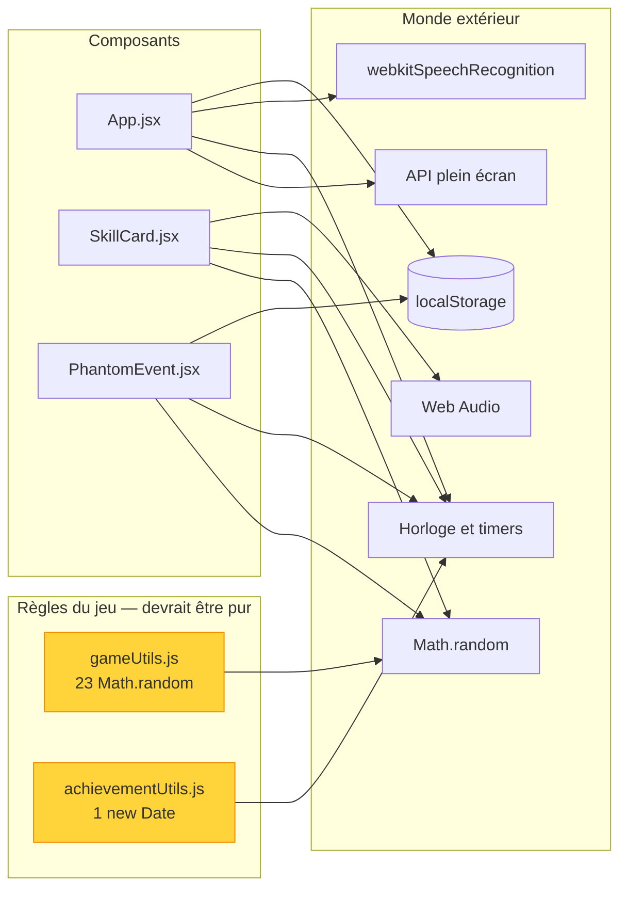

# Carte du code

> Mesurée sur `e82b673`. Le code de `src/` n'a pas changé depuis `03b3be6`, la version
> reçue : seuls l'outillage et l'hygiène du dépôt ont bougé. Cette carte décrit donc aussi
> bien le projet tel qu'il nous a été remis.
>
> Pièce du registre de dette exigée par le sujet, page 4 : modules principaux, graphe
> d'appel, où vit l'état, où se font les I/O.

6938 lignes de source réparties sur 24 fichiers. Pas de routeur, pas de conteneur d'état,
pas de couche service. Tout est client, il n'y a pas de backend.

## 1. Graphe de dépendances

```mermaid
graph TD
    main[main.jsx] --> App

    App[App.jsx<br/>1492 lignes]

    App --> SkillCard[skills/SkillCard.jsx<br/>778 lignes]
    App --> MenuDrawer[drawers/MenuDrawer.jsx]
    App --> SettingsDrawer[drawers/SettingsDrawer.jsx]
    App --> CosmeticsDrawer[drawers/CosmeticsDrawer.jsx]
    App --> PhantomEvent[PhantomEvent.jsx]
    App --> ResetModal[modals/ResetModal.jsx]
    App --> BugReportModal[modals/BugReportModal.jsx]
    App --> AchievementToast[ui/AchievementToast.jsx]
    App --> GlobalStyles[ui/GlobalStyles.jsx<br/>1302 lignes]
    App --> PixelHeart[ui/PixelHeart.jsx]

    SettingsDrawer --> ProfileCard[profile/ProfileCard.jsx]
    ProfileCard --> ParentalModal[ui/ParentalVerificationModal.jsx]
    SkillCard --> ParentalModal
    SkillCard --> MobWithAura[ui/MobWithAura.jsx]

    SafeImage[ui/SafeImage.jsx]
    MobWithAura --> SafeImage
    SkillCard --> SafeImage
    ProfileCard --> SafeImage
    MenuDrawer --> SafeImage
    CosmeticsDrawer --> SafeImage
    App --> SafeImage

    gameUtils[utils/gameUtils.js]
    soundManager[utils/soundManager.js]
    achievementUtils[utils/achievementUtils.js]
    mobDisplayUtils[utils/mobDisplayUtils.js]
    gameData[constants/gameData.jsx]
    achievements[constants/achievements.js]

    App --> gameUtils & soundManager & achievementUtils & mobDisplayUtils & gameData
    SkillCard --> gameUtils & soundManager & mobDisplayUtils & gameData
    MenuDrawer --> gameUtils & achievementUtils & gameData & achievements
    PhantomEvent --> soundManager & gameData
    CosmeticsDrawer --> gameData & achievements
    AchievementToast --> achievements
    gameUtils --> gameData
    achievementUtils --> achievements

    dead1[constants/assets.js<br/>MORT]
    dead2[drawers/MenuDrawer_old.jsx<br/>MORT]

    classDef hot fill:#ff6b6b,stroke:#c92a2a,color:#fff
    classDef dead fill:#868e96,stroke:#495057,color:#fff,stroke-dasharray: 5 5
    class App,SkillCard,GlobalStyles hot
    class dead1,dead2 dead
```



Ce qu'il faut lire dans ce graphe :

- **`App.jsx` touche tout.** Il importe 16 modules internes sur les 20 qu'il pourrait importer. Rien ne passe à côté de lui.
- **La hiérarchie est plate.** Deux niveaux au plus sous `App`. Aucun composant intermédiaire
  ne regroupe quoi que ce soit : toute la composition est faite à la main dans `App`.
- **Aucune dépendance circulaire.** C'est le point positif de cette structure.
- **Deux fichiers morts**, importés par personne : `constants/assets.js` et
  `drawers/MenuDrawer_old.jsx`.

## 2. Les modules

| Module | Lignes | Rôle |
|---|---:|---|
| `App.jsx` | 1492 | Racine. Détient tout l'état du jeu, orchestre les combats, les profils, les thèmes et la reconnaissance vocale |
| `components/ui/GlobalStyles.jsx` | 1302 | Tout le CSS de l'application, en CSS-in-JS, dans un seul composant |
| `components/skills/SkillCard.jsx` | 778 | Les six mini-jeux dans un seul composant, plus l'affichage de la carte de compétence |
| `constants/gameData.jsx` | 416 | Thèmes, mobs, mots, recettes, difficultés. La base de données du jeu |
| `utils/gameUtils.js` | 363 | Règles : dégâts, PV, XP, niveaux, tirage des mobs, génération des exercices |
| `components/drawers/CosmeticsDrawer.jsx` | 322 | Panneau des cosmétiques (bordures, couleurs) |
| `constants/achievements.js` | 318 | 19 achievements, dont 3 paliérisés à 8 niveaux |
| `utils/soundManager.js` | 287 | Musique de fond et effets sonores |
| `components/drawers/MenuDrawer.jsx` | 262 | Menu principal, progression, achievements |
| `utils/achievementUtils.js` | 217 | Déblocage, paliers, détection des transitions |
| `components/PhantomEvent.jsx` | 150 | Événement aléatoire : un Phantom traverse l'écran |
| `components/profile/ProfileCard.jsx` | 142 | Carte de profil dans les réglages |
| `components/ui/ParentalVerificationModal.jsx` | 125 | Contrôle parental |
| *autres* | < 110 | `PixelHeart`, `ResetModal`, `AchievementToast`, `SettingsDrawer`, `MobWithAura`, `SafeImage`, `BugReportModal`, `mobDisplayUtils` |

## 3. Où vit l'état

### État React

| Fichier | `useState` | `useRef` | `useEffect` |
|---|---:|---:|---:|
| `App.jsx` | **31** | 5 | 9 |
| `SkillCard.jsx` | **16** | 6 | 5 |
| `PhantomEvent.jsx` | 3 | 3 | 2 |
| `ProfileCard.jsx` | 3 | 0 | 1 |
| *6 autres composants* | 1 à 2 | 0 à 1 | 0 à 1 |

Il n'y a **ni conteneur d'état, ni contexte, ni reducer**. `App.jsx` détient 31 états et les
diffuse par props. `SettingsDrawer` reçoit à lui seul 14 props. Toute modification d'état
venue d'un enfant remonte par un callback passé depuis `App`.

### État persistant — `localStorage`

Lu et écrit depuis `App.jsx` (27 appels) et `PhantomEvent.jsx` (2 appels), jamais derrière une
abstraction.

| Clé | Contenu |
|---|---|
| `heroSkills_v23_p<1..3>` | Par profil : niveau, XP, difficulté, badges, mob courant, état de mort |
| `heroSkills_v23` | Clé héritée, encore lue une fois et migrée vers le profil 1 |
| `currentProfile_v1` | Profil actif |
| `heroProfileNames_v1` | Noms des trois profils |
| `heroParentStatus_v1` | Déverrouillage parental par profil |
| `borderEffect_p<id>`, `borderColor_p<id>` | Cosmétiques |
| `phantomEvent_lastSpawn_v1` | Cooldown de l'événement Phantom |

### État mutable de module

Deux variables globales dans `soundManager.js` :

```js
let bgmManagerInstance = null;   // singleton du lecteur de musique
let sfxVolume = 0.5;             // volume partagé par tout le jeu
```

C'est l'état que le sujet vise quand il parle de *purge globals* : il survit aux montages et
démontages, et deux tests qui tournent dans le même processus se le partagent.

## 4. Où se font les I/O

C'est la frontière que tout refactoring doit traverser, et la raison pour laquelle le code
est difficile à tester.

| Fichier | Stockage | Audio | Micro | Aléatoire | Timers | Horloge | Plein écran |
|---|---:|---:|---:|---:|---:|---:|---:|
| `App.jsx` | **27** | — | **4** | 1 | **13** | 1 | 2 |
| `SkillCard.jsx` | — | **6** | — | 5 | **12** | — | — |
| `gameUtils.js` | — | — | — | **23** | — | — | — |
| `PhantomEvent.jsx` | 2 | — | — | 3 | 3 | 2 | — |
| `soundManager.js` | — | 5 | — | 1 | — | — | — |
| `achievementUtils.js` | — | — | — | — | — | 1 | — |
| `mobDisplayUtils.js` | — | — | — | 1 | — | — | — |
| **Total** | **29** | **11** | **4** | **34** | **28** | **4** | **2** |

Aucun de ces appels ne passe par une interface. Tous sont faits directement sur les API du
navigateur, au milieu de la logique métier.



Les deux modules en jaune sont le problème le plus net : ce sont des **règles du jeu**, elles
devraient être pures et donc triviales à tester, mais elles tirent leur propre aléatoire et
lisent l'horloge. C'est la couture que le sujet désigne quand il demande *« how do you write
a reliable test for code that reads the clock, draws random numbers, plays sounds or listens
to the microphone? The answer will shape your architecture. »*

### Réseau

**Aucun appel réseau** dans le code applicatif. Quatre ressources externes sont néanmoins
chargées par le navigateur :

| Ressource | Origine | Utilisée par |
|---|---|---|
| Police VT323 | `fonts.googleapis.com` | `index.css` et `GlobalStyles.jsx`, importée deux fois |
| Texture `cubes.png` | `transparenttextures.com` | `SkillCard.jsx` |
| Texture `diagmonds-light.png` | `transparenttextures.com` | `ProfileCard.jsx` |
| Logo de repli | `placehold.co` | `App.jsx`, quand le logo du thème manque |

En build Electron hors ligne, les quatre échouent en silence : la police retombe sur une
police système, les textures disparaissent, et le logo de repli ne s'affiche pas — ce qui
rend un thème sans logo totalement muet visuellement.

## 5. Ce que la carte révèle

1. **`App.jsx` est le point de passage obligé.** 1492 lignes, 31 états, 16 imports, 27 accès
   au stockage. Toute mission y touchera, et deux personnes qui travaillent en parallèle y
   entreront en conflit.
2. **Les règles du jeu ne sont pas isolables en l'état.** 23 `Math.random` dans `gameUtils`
   et une horloge dans `achievementUtils` : impossible de prédire une sortie sans injecter
   ces dépendances.
3. **Le stockage n'a pas d'abstraction.** Neuf clés, deux schémas de nommage, une clé héritée
   migrée à la volée, le tout en appels directs. Un changement de format n'a aucun endroit
   unique où être traité.
4. **Deux fichiers morts** entretiennent la confusion sur ce qui fait autorité.
5. **Point positif** : aucune dépendance circulaire, et la couche `constants/` est purement
   déclarative. La base est saine, c'est la répartition qui ne l'est pas.

## Comment regénérer ces chiffres

```bash
npm run metrics:baseline        # tailles, complexité, duplication
```

Le graphe d'imports et les tableaux d'I/O sont produits par lecture directe de `src/` :

```bash
grep -rc "localStorage" src --include='*.js' --include='*.jsx'
grep -rc "Math.random" src --include='*.js' --include='*.jsx'
grep -rc "useState(" src --include='*.jsx'
```

Les diagrammes sont en Mermaid, dans ce fichier. Ils s'éditent en texte, ils ne demandent
aucun outil, et GitHub les rend tels quels.
